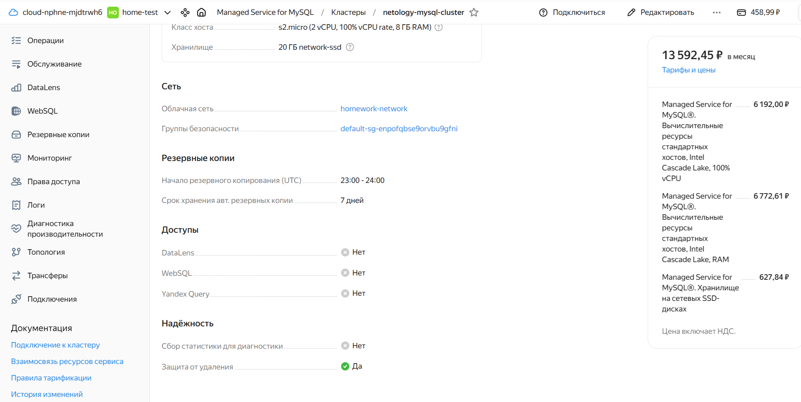
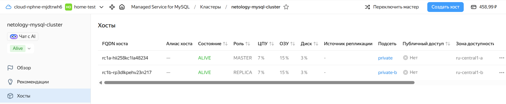
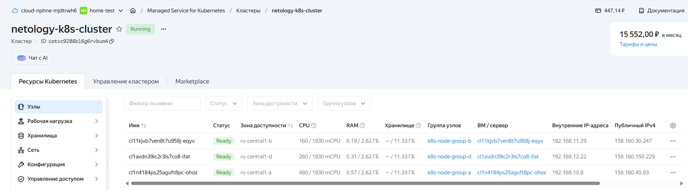
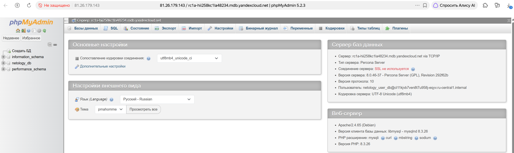

# Домашнее задание к занятию 23.4 "`Кластеры. Ресурсы под управлением облачных провайдеров`" - `Маховский Виктор`

### Цели задания 

1. Организация кластера Kubernetes и кластера баз данных MySQL в отказоустойчивой архитектуре.
2. Размещение в private подсетях кластера БД, а в public — кластера Kubernetes.

---
## Задание 1. Yandex Cloud

1. Настроить с помощью Terraform кластер баз данных MySQL.

 - Используя настройки VPC из предыдущих домашних заданий, добавить дополнительно подсеть private в разных зонах, чтобы обеспечить отказоустойчивость. 
 - Разместить ноды кластера MySQL в разных подсетях.
 - Необходимо предусмотреть репликацию с произвольным временем технического обслуживания.
 - Использовать окружение Prestable, платформу Intel Broadwell с производительностью 50% CPU и размером диска 20 Гб.
 - Задать время начала резервного копирования — 23:59.
 - Включить защиту кластера от непреднамеренного удаления.
 - Создать БД с именем `netology_db`, логином и паролем.

2. Настроить с помощью Terraform кластер Kubernetes.

 - Используя настройки VPC из предыдущих домашних заданий, добавить дополнительно две подсети public в разных зонах, чтобы обеспечить отказоустойчивость.
 - Создать отдельный сервис-аккаунт с необходимыми правами. 
 - Создать региональный мастер Kubernetes с размещением нод в трёх разных подсетях.
 - Добавить возможность шифрования ключом из KMS, созданным в предыдущем домашнем задании.
 - Создать группу узлов, состояющую из трёх машин с автомасштабированием до шести.
 - Подключиться к кластеру с помощью `kubectl`.
 - *Запустить микросервис phpmyadmin и подключиться к ранее созданной БД.
 - *Создать сервис-типы Load Balancer и подключиться к phpmyadmin. Предоставить скриншот с публичным адресом и подключением к БД.

Полезные документы:

- [MySQL cluster](https://registry.terraform.io/providers/yandex-cloud/yandex/latest/docs/resources/mdb_mysql_cluster).
- [Создание кластера Kubernetes](https://cloud.yandex.ru/docs/managed-kubernetes/operations/kubernetes-cluster/kubernetes-cluster-create)
- [K8S Cluster](https://registry.terraform.io/providers/yandex-cloud/yandex/latest/docs/resources/kubernetes_cluster).
- [K8S node group](https://registry.terraform.io/providers/yandex-cloud/yandex/latest/docs/resources/kubernetes_node_group).


### Ответ:

### Task 1

** Terraform plan **  
<details>
<summary>развернуть Terraform Plan</summary>  

```
user-test@ubuntu-26-hw:~/Netology/Terraform$ terraform plan

Terraform used the selected providers to generate the following execution plan. Resource actions are indicated with the following symbols:
  + create

Terraform will perform the following actions:

  # yandex_kms_symmetric_key.storage_kms_key will be created
  + resource "yandex_kms_symmetric_key" "storage_kms_key" {
      + created_at          = (known after apply)
      + default_algorithm   = "AES_256"
      + deletion_protection = false
      + description         = "Ключ для шифрования содержимого Object Storage"
      + folder_id           = (known after apply)
      + id                  = (known after apply)
      + name                = "storage-kms-key-hw23-3"
      + rotated_at          = (known after apply)
      + rotation_period     = "8760h"
      + status              = (known after apply)
    }

  # yandex_mdb_mysql_cluster.mysql_cluster will be created
  + resource "yandex_mdb_mysql_cluster" "mysql_cluster" {
      + allow_regeneration_host   = false
      + backup_retain_period_days = (known after apply)
      + created_at                = (known after apply)
      + deletion_protection       = true
      + environment               = "PRESTABLE"
      + folder_id                 = (known after apply)
      + health                    = (known after apply)
      + host_group_ids            = (known after apply)
      + id                        = (known after apply)
      + mysql_config              = (known after apply)
      + name                      = "netology-mysql-cluster"
      + network_id                = (known after apply)
      + status                    = (known after apply)
      + version                   = "8.0"

      + access (known after apply)

      + backup_window_start {
          + hours   = 23
          + minutes = 59
        }

      + host {
          + assign_public_ip   = false
          + fqdn               = (known after apply)
          + replication_source = (known after apply)
          + subnet_id          = (known after apply)
          + zone               = "ru-central1-a"
        }
      + host {
          + assign_public_ip   = false
          + fqdn               = (known after apply)
          + replication_source = (known after apply)
          + subnet_id          = (known after apply)
          + zone               = "ru-central1-b"
        }

      + maintenance_window {
          + type = "ANYTIME"
        }

      + performance_diagnostics (known after apply)

      + resources {
          + disk_size          = 20
          + disk_type_id       = "network-ssd"
          + resource_preset_id = "s2.micro"
        }
    }

  # yandex_mdb_mysql_database.netology_db will be created
  + resource "yandex_mdb_mysql_database" "netology_db" {
      + cluster_id = (known after apply)
      + id         = (known after apply)
      + name       = "netology_db"
    }

  # yandex_mdb_mysql_user.netology_user will be created
  + resource "yandex_mdb_mysql_user" "netology_user" {
      + authentication_plugin = "MYSQL_NATIVE_PASSWORD"
      + cluster_id            = (known after apply)
      + global_permissions    = (known after apply)
      + id                    = (known after apply)
      + name                  = "netology_user_db"
      + password              = (sensitive value)

      + connection_limits (known after apply)

      + permission {
          + database_name = "netology_db"
          + roles         = [
              + "ALL",
            ]
        }
    }

  # yandex_storage_bucket.hw23-3_bucket will be created
  + resource "yandex_storage_bucket" "hw23-3_bucket" {
      + acl                   = "public-read"
      + bucket                = "index-hw23-3-static-site"
      + bucket_domain_name    = (known after apply)
      + default_storage_class = (known after apply)
      + folder_id             = (known after apply)
      + force_destroy         = false
      + id                    = (known after apply)
      + website_domain        = (known after apply)
      + website_endpoint      = (known after apply)

      + anonymous_access_flags {
          + list = false
          + read = true
        }

      + server_side_encryption_configuration {
          + rule {
              + apply_server_side_encryption_by_default {
                  + kms_master_key_id = (known after apply)
                  + sse_algorithm     = "aws:kms"
                }
            }
        }

      + versioning (known after apply)

      + website {
          + index_document = "index.html"
        }
    }

  # yandex_storage_object.hw23-3_image will be created
  + resource "yandex_storage_object" "hw23-3_image" {
      + acl          = "public-read"
      + bucket       = "index-hw23-3-static-site"
      + content_type = "image/jpeg"
      + id           = (known after apply)
      + key          = "image.jpg"
      + source       = "image.jpg"
    }

  # yandex_storage_object.hw23-3_index will be created
  + resource "yandex_storage_object" "hw23-3_index" {
      + acl          = "public-read"
      + bucket       = "index-hw23-3-static-site"
      + content_type = "text/html"
      + id           = (known after apply)
      + key          = "index.html"
      + source       = "index.html"
    }

  # yandex_vpc_network.homework-network will be created
  + resource "yandex_vpc_network" "homework-network" {
      + created_at                = (known after apply)
      + default_security_group_id = (known after apply)
      + folder_id                 = (known after apply)
      + id                        = (known after apply)
      + labels                    = (known after apply)
      + name                      = "homework-network"
      + subnet_ids                = (known after apply)
    }

  # yandex_vpc_route_table.private-rt will be created
  + resource "yandex_vpc_route_table" "private-rt" {
      + created_at = (known after apply)
      + folder_id  = (known after apply)
      + id         = (known after apply)
      + labels     = (known after apply)
      + name       = "private-rt"
      + network_id = (known after apply)

      + static_route {
          + destination_prefix = "0.0.0.0/0"
          + next_hop_address   = "192.168.10.254"
            # (1 unchanged attribute hidden)
        }
    }

  # yandex_vpc_subnet.private-subnet will be created
  + resource "yandex_vpc_subnet" "private-subnet" {
      + created_at     = (known after apply)
      + folder_id      = (known after apply)
      + id             = (known after apply)
      + labels         = (known after apply)
      + name           = "private"
      + network_id     = (known after apply)
      + route_table_id = (known after apply)
      + v4_cidr_blocks = [
          + "192.168.20.0/24",
        ]
      + v6_cidr_blocks = (known after apply)
      + zone           = "ru-central1-a"
    }

  # yandex_vpc_subnet.private-subnet-b will be created
  + resource "yandex_vpc_subnet" "private-subnet-b" {
      + created_at     = (known after apply)
      + folder_id      = (known after apply)
      + id             = (known after apply)
      + labels         = (known after apply)
      + name           = "private-b"
      + network_id     = (known after apply)
      + route_table_id = (known after apply)
      + v4_cidr_blocks = [
          + "192.168.30.0/24",
        ]
      + v6_cidr_blocks = (known after apply)
      + zone           = "ru-central1-b"
    }

  # yandex_vpc_subnet.public-subnet will be created
  + resource "yandex_vpc_subnet" "public-subnet" {
      + created_at     = (known after apply)
      + folder_id      = (known after apply)
      + id             = (known after apply)
      + labels         = (known after apply)
      + name           = "public"
      + network_id     = (known after apply)
      + v4_cidr_blocks = [
          + "192.168.10.0/24",
        ]
      + v6_cidr_blocks = (known after apply)
      + zone           = "ru-central1-a"
    }

Plan: 12 to add, 0 to change, 0 to destroy.

Changes to Outputs:
  + bucket_name        = "index-hw23-3-static-site"
  + image_url          = "https://index-hw23-3-static-site.storage.yandexcloud.net/image.jpg"
  + kms_key_id         = (known after apply)
  + mysql_cluster_fqdn = (known after apply)
  + mysql_cluster_id   = (known after apply)
  + website_url        = "http://index-hw23-3-static-site.website.yandexcloud.net"

───────────────────────────────────────────────────────────────────────────────────────────────────────────────────────────────────────────────────────────────────────────────────────

Note: You didn't use the -out option to save this plan, so Terraform can't guarantee to take exactly these actions if you run "terraform apply" now.
```

</details>

** Проверяем в Yandex Cloud netology-mysql-cluster **      




** Проверяем в Yandex Cloud netology-mysql-cluster hosts **       




### Task 2

** Terraform plan **  
<details>
<summary>развернуть Terraform Plan</summary>  

```
user-test@ubuntu-26-hw:~/Netology/Terraform$ terraform plan
yandex_vpc_network.homework-network: Refreshing state... [id=enpofqbse9orvbu9gfni]
yandex_kms_symmetric_key.storage_kms_key: Refreshing state... [id=abjcc35ukhk4dpvtvndq]
yandex_storage_bucket.hw23-3_bucket: Refreshing state... [id=index-hw23-3-static-site]
yandex_vpc_route_table.private-rt: Refreshing state... [id=enp7c952eib1rhff6htm]
yandex_vpc_subnet.public-subnet: Refreshing state... [id=e9bhrhntq1hpcu59p21d]
yandex_vpc_subnet.private-subnet: Refreshing state... [id=e9bi1mn8726gtq9nusdm]
yandex_vpc_subnet.private-subnet-b: Refreshing state... [id=e2la3ddt7ebffidlb1q2]
yandex_mdb_mysql_cluster.mysql_cluster: Refreshing state... [id=c9q68dmojrcvh4u2vjk7]
yandex_storage_object.hw23-3_image: Refreshing state... [id=image.jpg]
yandex_storage_object.hw23-3_index: Refreshing state... [id=index.html]

Note: Objects have changed outside of Terraform

Terraform detected the following changes made outside of Terraform since the last "terraform apply" which may have affected this plan:

  # yandex_mdb_mysql_cluster.mysql_cluster has changed
  ~ resource "yandex_mdb_mysql_cluster" "mysql_cluster" {
        id                      = "c9q68dmojrcvh4u2vjk7"
        name                    = "netology-mysql-cluster"
        # (6 unchanged attributes hidden)

      ~ host {
          + fqdn                    = "rc1a-hii258kc1la48234.mdb.yandexcloud.net"
            name                    = null
            # (7 unchanged attributes hidden)
        }

        # (4 unchanged blocks hidden)
    }


Unless you have made equivalent changes to your configuration, or ignored the relevant attributes using ignore_changes, the following plan may include actions to undo or respond to
these changes.

───────────────────────────────────────────────────────────────────────────────────────────────────────────────────────────────────────────────────────────────────────────────────────

Terraform used the selected providers to generate the following execution plan. Resource actions are indicated with the following symbols:
  + create

Terraform will perform the following actions:

  # yandex_iam_service_account.k8s_sa will be created
  + resource "yandex_iam_service_account" "k8s_sa" {
      + created_at = (known after apply)
      + folder_id  = (known after apply)
      + id         = (known after apply)
      + name       = "k8s-service-account"
    }

  # yandex_kubernetes_cluster.k8s_cluster will be created
  + resource "yandex_kubernetes_cluster" "k8s_cluster" {
      + cluster_ipv4_range       = (known after apply)
      + cluster_ipv6_range       = (known after apply)
      + created_at               = (known after apply)
      + description              = (known after apply)
      + folder_id                = (known after apply)
      + health                   = (known after apply)
      + id                       = (known after apply)
      + labels                   = (known after apply)
      + log_group_id             = (known after apply)
      + name                     = "netology-k8s-cluster"
      + network_id               = "enpofqbse9orvbu9gfni"
      + node_ipv4_cidr_mask_size = 24
      + node_service_account_id  = (known after apply)
      + release_channel          = (known after apply)
      + service_account_id       = (known after apply)
      + service_ipv4_range       = (known after apply)
      + service_ipv6_range       = (known after apply)
      + status                   = (known after apply)

      + kms_provider {
          + key_id = "abjcc35ukhk4dpvtvndq"
        }

      + master {
          + cluster_ca_certificate = (known after apply)
          + etcd_cluster_size      = (known after apply)
          + external_v4_address    = (known after apply)
          + external_v4_endpoint   = (known after apply)
          + external_v6_endpoint   = (known after apply)
          + internal_v4_address    = (known after apply)
          + internal_v4_endpoint   = (known after apply)
          + public_ip              = true
          + version                = (known after apply)
          + version_info           = (known after apply)

          + maintenance_policy (known after apply)

          + master_location (known after apply)

          + regional {
              + region = "ru-central1"

              + location {
                  + subnet_id = "e9bhrhntq1hpcu59p21d"
                  + zone      = "ru-central1-a"
                }
              + location {
                  + subnet_id = (known after apply)
                  + zone      = "ru-central1-b"
                }
              + location {
                  + subnet_id = (known after apply)
                  + zone      = "ru-central1-d"
                }
            }

          + zonal (known after apply)
        }
    }

  # yandex_kubernetes_node_group.k8s_node_group will be created
  + resource "yandex_kubernetes_node_group" "k8s_node_group" {
      + cluster_id        = (known after apply)
      + created_at        = (known after apply)
      + description       = (known after apply)
      + id                = (known after apply)
      + instance_group_id = (known after apply)
      + labels            = (known after apply)
      + name              = "k8s-node-group"
      + status            = (known after apply)
      + version           = (known after apply)
      + version_info      = (known after apply)

      + allocation_policy {
          + location {
              + subnet_id = (known after apply)
              + zone      = "ru-central1-a"
            }
          + location {
              + subnet_id = (known after apply)
              + zone      = "ru-central1-b"
            }
          + location {
              + subnet_id = (known after apply)
              + zone      = "ru-central1-d"
            }
        }

      + deploy_policy (known after apply)

      + instance_template {
          + metadata                  = (known after apply)
          + nat                       = (known after apply)
          + network_acceleration_type = (known after apply)
          + platform_id               = "standard-v3"

          + boot_disk {
              + size = 32
              + type = "network-ssd"
            }

          + container_network (known after apply)

          + container_runtime (known after apply)

          + gpu_settings (known after apply)

          + network_interface {
              + ipv4       = true
              + ipv6       = (known after apply)
              + nat        = true
              + subnet_ids = (known after apply)
            }

          + resources {
              + core_fraction = 50
              + cores         = 2
              + gpus          = 0
              + memory        = 4
            }

          + scheduling_policy (known after apply)
        }

      + maintenance_policy (known after apply)

      + scale_policy {
          + auto_scale {
              + initial = 3
              + max     = 6
              + min     = 3
            }
        }
    }

  # yandex_mdb_mysql_database.netology_db will be created
  + resource "yandex_mdb_mysql_database" "netology_db" {
      + cluster_id = "c9q68dmojrcvh4u2vjk7"
      + id         = (known after apply)
      + name       = "netology_db"
    }

  # yandex_mdb_mysql_user.netology_user will be created
  + resource "yandex_mdb_mysql_user" "netology_user" {
      + authentication_plugin = "MYSQL_NATIVE_PASSWORD"
      + cluster_id            = "c9q68dmojrcvh4u2vjk7"
      + global_permissions    = (known after apply)
      + id                    = (known after apply)
      + name                  = "netology_user_db"
      + password              = (sensitive value)

      + connection_limits (known after apply)

      + permission {
          + database_name = "netology_db"
          + roles         = [
              + "ALL",
            ]
        }
    }

  # yandex_resourcemanager_folder_iam_member.k8s_sa_roles["container-registry.images.puller"] will be created
  + resource "yandex_resourcemanager_folder_iam_member" "k8s_sa_roles" {
      + folder_id = "b1gig4al4b2hsk3a8eld"
      + id        = (known after apply)
      + member    = (known after apply)
      + role      = "container-registry.images.puller"
    }

  # yandex_resourcemanager_folder_iam_member.k8s_sa_roles["editor"] will be created
  + resource "yandex_resourcemanager_folder_iam_member" "k8s_sa_roles" {
      + folder_id = "b1gig4al4b2hsk3a8eld"
      + id        = (known after apply)
      + member    = (known after apply)
      + role      = "editor"
    }

  # yandex_resourcemanager_folder_iam_member.k8s_sa_roles["k8s.clusters.agent"] will be created
  + resource "yandex_resourcemanager_folder_iam_member" "k8s_sa_roles" {
      + folder_id = "b1gig4al4b2hsk3a8eld"
      + id        = (known after apply)
      + member    = (known after apply)
      + role      = "k8s.clusters.agent"
    }

  # yandex_resourcemanager_folder_iam_member.k8s_sa_roles["k8s.nodes.agent"] will be created
  + resource "yandex_resourcemanager_folder_iam_member" "k8s_sa_roles" {
      + folder_id = "b1gig4al4b2hsk3a8eld"
      + id        = (known after apply)
      + member    = (known after apply)
      + role      = "k8s.nodes.agent"
    }

  # yandex_resourcemanager_folder_iam_member.k8s_sa_roles["vpc.publicAdmin"] will be created
  + resource "yandex_resourcemanager_folder_iam_member" "k8s_sa_roles" {
      + folder_id = "b1gig4al4b2hsk3a8eld"
      + id        = (known after apply)
      + member    = (known after apply)
      + role      = "vpc.publicAdmin"
    }

  # yandex_vpc_subnet.public-subnet-b will be created
  + resource "yandex_vpc_subnet" "public-subnet-b" {
      + created_at     = (known after apply)
      + folder_id      = (known after apply)
      + id             = (known after apply)
      + labels         = (known after apply)
      + name           = "public-b"
      + network_id     = "enpofqbse9orvbu9gfni"
      + v4_cidr_blocks = [
          + "192.168.11.0/24",
        ]
      + v6_cidr_blocks = (known after apply)
      + zone           = "ru-central1-b"
    }

  # yandex_vpc_subnet.public-subnet-d will be created
  + resource "yandex_vpc_subnet" "public-subnet-d" {
      + created_at     = (known after apply)
      + folder_id      = (known after apply)
      + id             = (known after apply)
      + labels         = (known after apply)
      + name           = "public-d"
      + network_id     = "enpofqbse9orvbu9gfni"
      + v4_cidr_blocks = [
          + "192.168.12.0/24",
        ]
      + v6_cidr_blocks = (known after apply)
      + zone           = "ru-central1-d"
    }

Plan: 12 to add, 0 to change, 0 to destroy.

Changes to Outputs:
  + k8s_cluster_id     = (known after apply)
  + k8s_cluster_name   = "netology-k8s-cluster"
  + mysql_cluster_fqdn = "rc1a-hii258kc1la48234.mdb.yandexcloud.net"
  + mysql_cluster_id   = "c9q68dmojrcvh4u2vjk7"

───────────────────────────────────────────────────────────────────────────────────────────────────────────────────────────────────────────────────────────────────────────────────────

Note: You didn't use the -out option to save this plan, so Terraform can't guarantee to take exactly these actions if you run "terraform apply" now.
```

</details>


** Проверяем в Yandex Cloud netology-k8s-cluster **      




** Проверяем phpmyadmin **       




--- 
## Задание 2*. Вариант с AWS (задание со звёздочкой)

Это необязательное задание. Его выполнение не влияет на получение зачёта по домашней работе.

**Что нужно сделать**

1. Настроить с помощью Terraform кластер EKS в три AZ региона, а также RDS на базе MySQL с поддержкой MultiAZ для репликации и создать два readreplica для работы.
 
 - Создать кластер RDS на базе MySQL.
 - Разместить в Private subnet и обеспечить доступ из public сети c помощью security group.
 - Настроить backup в семь дней и MultiAZ для обеспечения отказоустойчивости.
 - Настроить Read prelica в количестве двух штук на два AZ.

2. Создать кластер EKS на базе EC2.

 - С помощью Terraform установить кластер EKS на трёх EC2-инстансах в VPC в public сети.
 - Обеспечить доступ до БД RDS в private сети.
 - С помощью kubectl установить и запустить контейнер с phpmyadmin (образ взять из docker hub) и проверить подключение к БД RDS.
 - Подключить ELB (на выбор) к приложению, предоставить скрин.

Полезные документы:

- [Модуль EKS](https://learn.hashicorp.com/tutorials/terraform/eks).

### Правила приёма работы

Домашняя работа оформляется в своём Git репозитории в файле README.md. Выполненное домашнее задание пришлите ссылкой на .md-файл в вашем репозитории.
Файл README.md должен содержать скриншоты вывода необходимых команд, а также скриншоты результатов.
Репозиторий должен содержать тексты манифестов или ссылки на них в файле README.md.

---

## Задание 2*. AWS (задание со звёздочкой)

Это необязательное задание. Его выполнение не влияет на получение зачёта по домашней работе.

**Что нужно сделать**

1. С помощью роли IAM записать файлы ЕС2 в S3-бакет:
 - создать роль в IAM для возможности записи в S3 бакет;
 - применить роль к ЕС2-инстансу;
 - с помощью bootstrap-скрипта записать в бакет файл веб-страницы.
2. Организация шифрования содержимого S3-бакета:

 - используя конфигурации, выполненные в домашнем задании из предыдущего занятия, добавить к созданному ранее бакету S3 возможность шифрования Server-Side, используя общий ключ;
 - включить шифрование SSE-S3 бакету S3 для шифрования всех вновь добавляемых объектов в этот бакет.

3. *Создание сертификата SSL и применение его к ALB:

 - создать сертификат с подтверждением по email;
 - сделать запись в Route53 на собственный поддомен, указав адрес LB;
 - применить к HTTPS-запросам на LB созданный ранее сертификат.

Resource Terraform:

- [IAM Role](https://registry.terraform.io/providers/hashicorp/aws/latest/docs/resources/iam_role).
- [AWS KMS](https://registry.terraform.io/providers/hashicorp/aws/latest/docs/resources/kms_key).
- [S3 encrypt with KMS key](https://registry.terraform.io/providers/hashicorp/aws/latest/docs/resources/s3_bucket_object#encrypting-with-kms-key).

Пример bootstrap-скрипта:

```
#!/bin/bash
yum install httpd -y
service httpd start
chkconfig httpd on
cd /var/www/html
echo "<html><h1>My cool web-server</h1></html>" > index.html
aws s3 mb s3://mysuperbacketname2021
aws s3 cp index.html s3://mysuperbacketname2021
```

### Правила приёма работы

Домашняя работа оформляется в своём Git репозитории в файле README.md. Выполненное домашнее задание пришлите ссылкой на .md-файл в вашем репозитории.
Файл README.md должен содержать скриншоты вывода необходимых команд, а также скриншоты результатов.
Репозиторий должен содержать тексты манифестов или ссылки на них в файле README.md.


